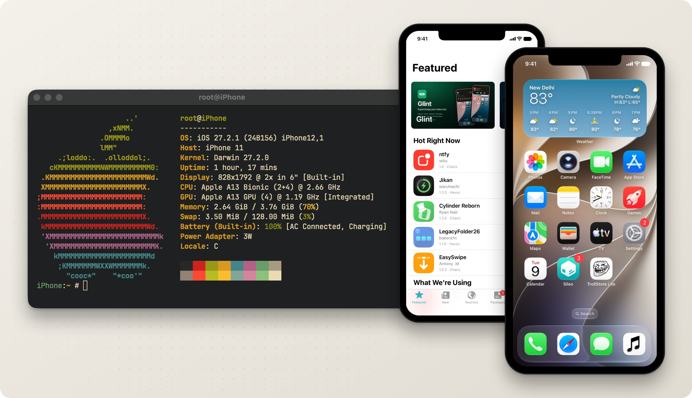

<div align="center">

# Liter8

Tethered iOS 27 jailbreak for iPhone 11.

   [](https://buymeacoffee.com/xplo8e)

<picture>
  <source media="(prefers-color-scheme: dark)" srcset="./docs/images/hero-dark.png">
  
</picture>

</div>

> [!IMPORTANT]
> **Tethered.** The phone only boots from pwn DFU with `fw boot`, so the Mac has to be there every single time. No Mac, no boot.
>
> **iPhone 11 only** (`iPhone12,1`, `n104ap`). I don't own another A13 device, so that's all I'm willing to claim.

## Status

### Works

- **Boot**: normal boot to the home screen, root SSH, apt and Sileo, TrollStore, apps launch
- **App Store**: Apple ID sign-in and app installs
- **Tweaks**: ElleKit injection, ObjC and C function hooks. See [using the tweak loader](docs/USING_TWEAKS.md)
- **Keychain**
- **tfp0**: kernel read/write for `libkrw0-tfp0`, with `fw get-boot --tfp0`
- **Cellular**: no flags needed. SIM ready, carrier bundle matched, registered on the network
- **Calls and SMS**: over IMS, carried by WiFi Calling, so they need WiFi connected *and* WiFi Calling on
- **Developer tools**: USB lockdown pairing, same-boot RemoteXPC reconnect, QuickTime capture, and CoreDevice process listing and screenshots once the DeveloperDiskImage jobs are up

### Doesn't work yet

- **SEP**, and passcode with it
- **Cellular data**, and VoLTE with it. The bearer comes up with a real carrier address and the modem acknowledges every instruction, but nothing ever comes back. Narrowed to inside the baseband, with everything above it ruled out: [the blocker, and what was eliminated](docs/CELLULAR_DATA_BLOCKER.md)
- **Apple services**, iCloud included (the App Store is the exception, see above). Push has no token, because minting one needs a real activation record, which needs a SEP-attested key. Measured, not assumed
- **MobileBackup2**. Both clients reach the service and negotiate, then the backup fails because the boot has no normal persona state

PRs welcome on any of these, especially SEP.

## Supported firmware

| Firmware        | Build      | iPhone 11 | 11 Pro       | 11 Pro Max   |
| --------------- | ---------- | --------- | ------------ | ------------ |
| iOS 27.0 beta 4 | `24A5390f` | run       | -            | -            |
| iOS 27.0 RC     | `24A435`   | run       | -            | -            |
| iOS 27.0        | `24A437`   | -         | experimental | experimental |
| iOS 27.0.1      | `24A446`   | run       | experimental | experimental |
| iOS 27.2 beta 1 | `24B5084k` | run       | -            | -            |
| iOS 27.2 beta 2 | `24B5089g` | run       | -            | -            |
| iOS 27.2 beta 3 | `24B5099f` | run       | -            | -            |
| iOS 27.2 beta 4 | `24B5110a` | run       | -            | -            |
| iOS 27.2        | `24B119`   | run       | experimental | experimental |
| iOS 27.2.1      | `24B156`   | run       | experimental | experimental |
| iOS 27.3 beta 1 | `24C5037i` | run       | experimental | experimental |

**run**: I did an erase restore, booted it normally, then rebooted and it came back up.

**experimental**: resolves, and you can use it with `--experimental`, but nobody has confirmed it on that phone. The 11 Pro and Pro Max have profiles and no device to test on. If you own one and try it, tell me what happens and I'll change the tag.

> [!WARNING]
> `fw restore-cfw` pulls a fresh APTicket from Apple during the restore, so once Apple stops signing a build you can't install it anymore. A row stays in the table because I tested it, not because you can still use it today. Check signing first.

A build that isn't in the table extracts for research only, and `make-cfw`, restore, boot and provision all refuse it. The profiles don't carry offsets either, so adding a build isn't a matter of pasting numbers in. The resolvers work them out at runtime.

## Install

You need macOS 14 or newer, Xcode command line tools with Swift 6, and Homebrew.

```sh
brew install \
  sevenzip blacktop/tap/ipsw gnu-tar coreutils zstd ldid-procursus sshpass autoconf automake libtool pkg-config \
  libimobiledevice libimobiledevice-glue libirecovery libusbmuxd libplist libtatsu libzip curl
```

```sh
git clone --recurse-submodules https://github.com/Xplo8E/liter8.git
cd liter8
make setup
make release
```

The binary ends up at `.build/release/liter8`.

## Usage

Everything lands in one work directory: `WORK_DIR`, or `--work-dir`, or the directory you're standing in if you set neither.

Run the steps in order, every time. Each one eats the output of the one before it. Coming back to a phone days later, restart from `fw make-cfw` rather than guessing where you left off.

> [!CAUTION]
> Step 3 wipes the phone. Erase restore, everything gone, no undo. Read the IPSW path, the device, the build, the board and the work dir twice before you hit enter.

### 1. Prepare the IPSW

```sh
export WORK_DIR="$PWD/.liter8"
.build/release/liter8 fw prepare --file /path/to/firmware.ipsw
```

The build comes from `BuildManifest.plist`, not the file name. `IPSW_FILE` works in place of `--file`.

### 2. Build the CFW

```sh
.build/release/liter8 fw make-cfw
```

### 3. Restore it

Phone in pwn DFU, then:

```sh
.build/release/liter8 fw restore-cfw
```

It checks the CFW over, starts a local TSS proxy to catch the restore ticket on its way through, and shuts the proxy down once `idevicerestore` exits.

### 4. Boot the SSH ramdisk

Back to pwn DFU.

```sh
.build/release/liter8 fw get-rd
.build/release/liter8 fw boot-rd
```

### 5. Provision

The phone is in the SSH ramdisk now.

```sh
.build/release/liter8 fw bootstrap --check
.build/release/liter8 fw bootstrap
.build/release/liter8 fw prepare-rootfs
.build/release/liter8 fw provision --check
.build/release/liter8 fw provision
.build/release/liter8 fw unmount-rootfs
```

### 6. Boot iOS

pwn DFU again.

```sh
.build/release/liter8 fw get-boot
.build/release/liter8 fw boot
```

> [!TIP]
> Take the SIM out before going through Setup on a fresh restore. Cellular data doesn't work, so Setup can hang waiting on the network. Put it back once you're on the home screen.

### 7. Finish the bootstrap

Wait until you can SSH into the booted OS, then:

```sh
.build/release/liter8 fw finalize --check
.build/release/liter8 fw finalize
.build/release/liter8 fw finalize --check
```

The second `--check` is just so you can see it went through.

<details>
<summary><b>Build options</b>: <code>--serial</code>, <code>--tfp0</code>, and what TXM ships with</summary>

<br>

**`--serial`** on `fw make-cfw`, `fw get-rd` and `fw get-boot` writes `serial=3` into the boot args, which moves the kernel console onto the UART. Useful when a boot dies early. The downside is the phone screen goes quiet, no boot log on the device anymore. It's off by default, and because it gets baked in at build time you have to pass it to each command separately.

**`--tfp0`** on `fw get-boot` adds the tfp0 kernel patches used by `libkrw0-tfp0`. iPhone 11 only, on every build in the table except 27.0 beta 4. Off by default. The slide is handed out only when the kernel task is the one being asked about, so every other process keeps its real `TASK_DYLD_INFO` and lldb still sees a module list.

**TXM**: `fw get-boot` always builds TXM with its code-signing policy flags on (any signature, unrestricted local signing, relaxed profile trust, CS enforcement disabled, unrestricted task_for_pid) plus the patches C function hooks need. CoreTrust stays enforced. The boot manifest records it as `txmPlan: boot-permissive`.

</details>

<details>
<summary><b>Optional</b>: debugger and TrollStore</summary>

<br>

Not part of the jailbreak. The device needs internet for this one, because apt resolves the dependencies on the phone.

```sh
.build/release/liter8 fw setup-debugger
```

Installs `debugserver`, re-signed so hardware breakpoints work, plus the TrollStore Lite helper. Then:

```sh
ssh -p 2222 root@localhost \
  'nohup /var/jb/usr/bin/debugserver-16 127.0.0.1:1237 --attach=<pid> >/var/root/ds.log 2>&1 &'
ssh -N -L 1237:127.0.0.1:1237 -p 2222 root@127.0.0.1

lldb -o 'platform select remote-ios' -o 'process connect connect://127.0.0.1:1237'
(lldb) breakpoint set -H -n <symbol>
```

`-H` is not optional: software breakpoints are silently dropped on this platform. Attaching to a daemon also needs a DeviceSupport tree for your exact build, or lldb hangs on connect. Both are explained in [debugging platform daemons](docs/design/DEBUGGING_PLATFORM_DAEMONS.md).

</details>

## How it works

Liter8 doesn’t ship offset tables. Each time you build, it opens the actual binaries (iBoot, the kernel, TXM, a few userland daemons and the DeviceTree) and finds every patch site from scratch using strings, cross-references, control flow and the instructions around it. If an anchor can’t be found, or turns up in more than one place, it stops rather than take a guess.

A patch is three things: where to write, the bytes that should already be there, and the bytes that replace them. Nothing gets written until every patch in the plan has been checked. If a site still has its original bytes, the patch gets applied. If it already has the new bytes, it’s left alone. If it has anything else, the whole plan is rejected. So a plan either goes in completely or not at all, and running it a second time won’t break anything.

The Swift side does all of this. It also works out which firmware you gave it by reading BuildManifest.plist, and it handles IMG4, IM4P and APTickets. The Python side is mostly plumbing. It moves disk images around, stages files, runs idevicerestore and the USB tools, and takes the phone through each stage. Whenever a binary needs patching, Python hands it to the Swift binary, so you won’t find any patch logic or offsets in the Python code.

Firmware profiles don’t contain offsets either. A profile only decides which signature and payload variants match a given kernel. Every step that talks to the phone also checks the firmware identity again for itself instead of trusting an earlier check.

For the source layout and how execution moves through it, see [CODEBASE_GUIDE.md](CODEBASE_GUIDE.md).

## Docs

**Using it**
- [Using the tweak loader](docs/USING_TWEAKS.md)
- [Debugging platform daemons](docs/design/DEBUGGING_PLATFORM_DAEMONS.md)

**Design**
- [Architecture and onboarding](CODEBASE_GUIDE.md)
- [Firmware and device support guide](docs/FIRMWARE_SUPPORT_GUIDE.md)
- [Normal boot handoff](docs/design/NORMAL_BOOT_HANDOFF.md)
- [Bootstrap and provisioning status](docs/design/BOOTSTRAP_JB_STATUS.md)
- [How the cellular patches work](docs/design/CELLULAR_PATCHES.md): what each patch targets, changes and verifies
- [Performance backlog](docs/BACKLOG.md)

**Research and device runs**
- [Cellular data blocker](docs/CELLULAR_DATA_BLOCKER.md): why data still doesn't flow, what's been ruled out, and what's worth researching next
- [Baseband and cellular](docs/design/BASEBAND_AND_CELLULAR.md): how each problem was found, and what failed
- [iOS 27 `24A435` resolver and device evidence](docs/plans/IOS_27_24A435_RC_PATCHES.md)
- [iPhone 11 beta 4 device run](docs/runs/IOS_27_BETA4_IPHONE11.md)
- [iPhone 11 `24A446` pairing and watchdog research](docs/runs/IOS_27_24A446_PAIRING_AND_WATCHDOG.md)
- tfp0 kernel read/write on [`24A446`](docs/runs/IOS_27_24A446_TFP0.md) and [`24C5037i`](docs/runs/IOS_273_24C5037i_TFP0.md)

## Contributing and support

Start with [CONTRIBUTING.md](docs/CONTRIBUTING.md). If you're porting a firmware, read [ADDING_FIRMWARE_SUPPORT.md](docs/ADDING_FIRMWARE_SUPPORT.md) too.

PRs are welcome on anything under [Doesn't work yet](#doesnt-work-yet), especially SEP. The 11 Pro and Pro Max are open too: if you own one and want to take the port on, I'll help where I can. Or if you'd rather help on the hardware side, there's a [coffee link](https://buymeacoffee.com/xplo8e) and that's what it'd go towards. Either route is fine, and so is neither.

## Credits

None of this starts without these people.

- [wh1te4ever](https://github.com/wh1te4ever): [usbliter8-fun](https://github.com/wh1te4ever/usbliter8-fun), the beta 2/3 CFW and ramdisk work
- [34306](https://github.com/34306/usbliter8-fun) (Huy Nguyen): the fork, tutorial and original `patches/`
- [Procursus](https://github.com/ProcursusTeam): rootless bootstrap
- [khanhduytran0](https://github.com/khanhduytran0): DeviceTree and USB restriction ideas
- [tihmstar](https://github.com/tihmstar): `img4`, `img4tool`, APTicket signing
- [m1stadev](https://github.com/m1stadev), [doronz88](https://github.com/doronz88): `pyimg4`, `pymobiledevice3`
- [Lakr233](https://github.com/Lakr233): [vphone-cli](https://github.com/Lakr233/vphone-cli), `trollvnc`, USB device control

## License

MIT, see [LICENSE](LICENSE). Submodules, tools and payloads keep their own licenses.
